#  Fretbored

Guitar scales, chords, circle of fifths and a precise metronome — in the browser, with no dependencies.

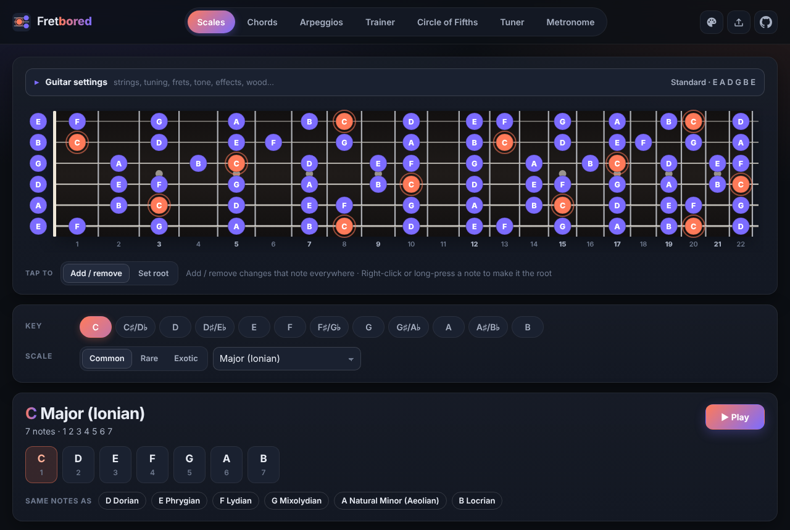

- **Scales**: any key, ~55 scales across Common / Rare / Exotic. Click frets to add or remove notes and Fretbored works out which scale you've made; right-click or long-press to change the root.
- **Chords**: 12 core chord types plus ~25 advanced ones, generated as playable voicings for your tuning in several positions up the neck, shown as a chord diagram and as tablature (e.g. x32010). Edit the shape and the chord is re-identified (including slash chords).
- **Arpeggios**: arpeggio shapes for every chord type — the five CAGED positions or sweep-picking shapes (6/5/4/3-string) — shown on the fretboard and as tablature, with up/down playback from slow up to “max shred” (20 notes a second). Tap notes on the fretboard to build your own shape and the arpeggio is identified that follows along in the tab.
- **Circle of Fifths**: pick a key and mode to see diatonic chords with Roman numerals, key signature and related keys.
- **Trainer**: fretboard note games — name the highlighted note, or find every place a note occurs — with fret/string practice areas, naturals-only, weak-spot focus, sound, a 60-second challenge, a daily streak (50 notes a day), and saved progress (7-day history, accuracy by note and string).
- **Tuner**: traditional needle and strobe modes, instrument (per-string, using your tuning) or chromatic, adjustable A4 reference and reference tones.
- **Metronome**: tap tempo, accents, odd-meter grouping, subdivisions, step and gradual tempo trainer, gap trainer, and a visual-sync adjustment for devices with audio delay. Sample-accurate Web Audio scheduling.
- Shared fretboard settings: 4–8 strings (guitar and bass), preset and custom tunings, 21/22/24 frets, note or interval labels (note dot colours follow the app theme), clean or overdriven guitar tone with palm mute, reverb and delay, ebony/rosewood/maple, left-handed mode, and a sideways or vertical layout on phones (the vertical board on Chords and Arpeggios shows just the current shape, with a button for the whole neck).
- App colour themes: Dark (default), Light, AMOLED Black, Dracula, Solarized, Tokyo Night and Catppuccin Latte / Frappé / Macchiato / Mocha — pick one from the palette button at the top.
- Back up everything (settings, custom tunings, Trainer history and streak) to a file and import it on another device — the ⤒ button at the top.
- On phones, swipe the page left or right to move between tabs — the page follows your finger.

## Screenshots

| Chords | Arpeggios |
| --- | --- |
| 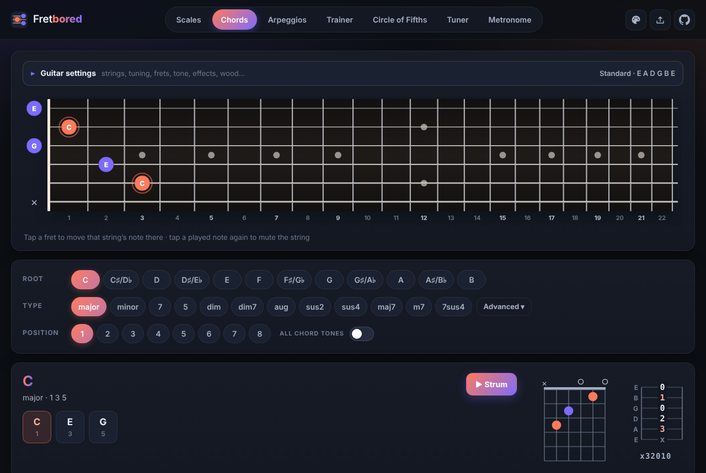 | 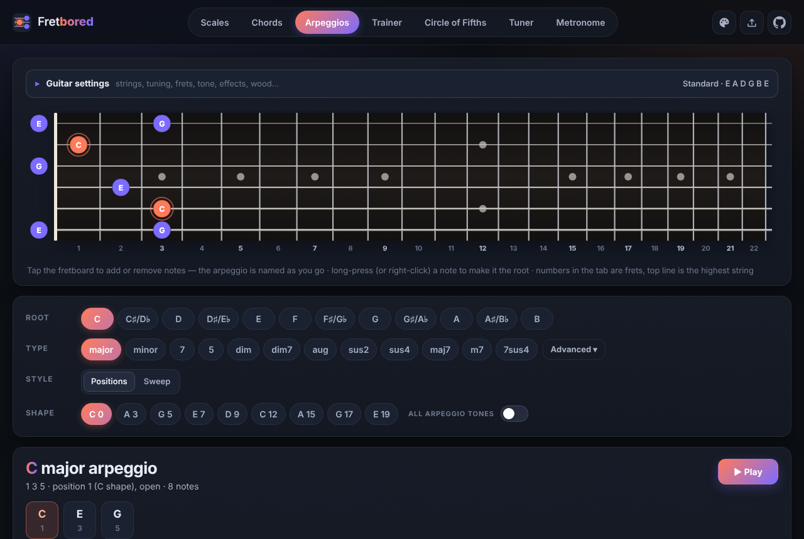 |
| **Trainer** | **Circle of Fifths** |
| 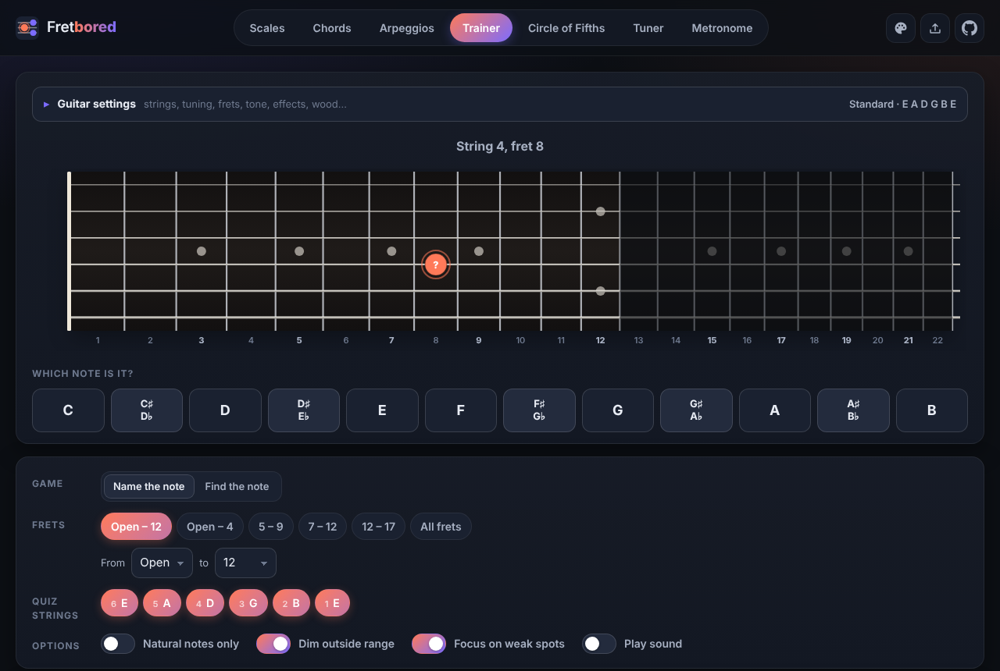 | 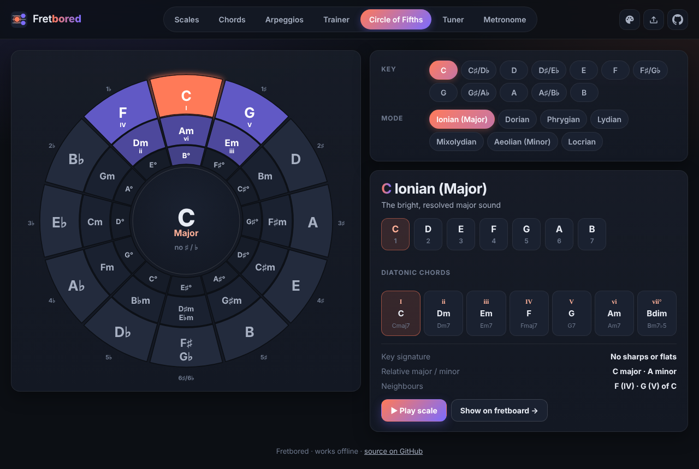 |
| **Tuner** | **Metronome** |
| 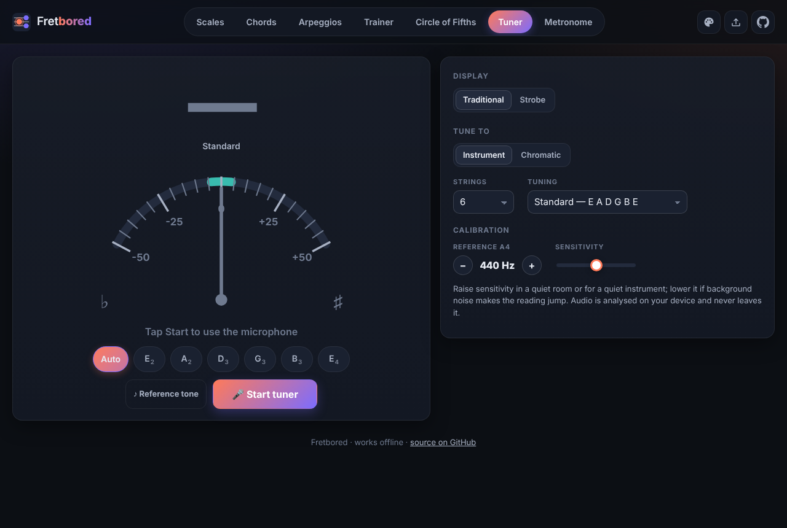 | 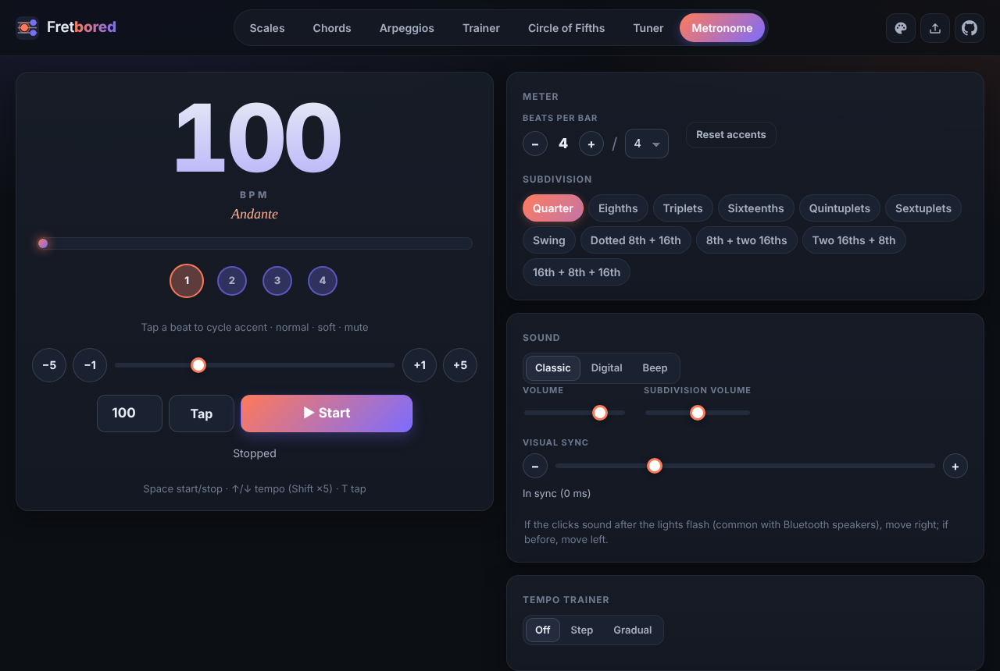 |

On a phone (vertical fretboard layout):

  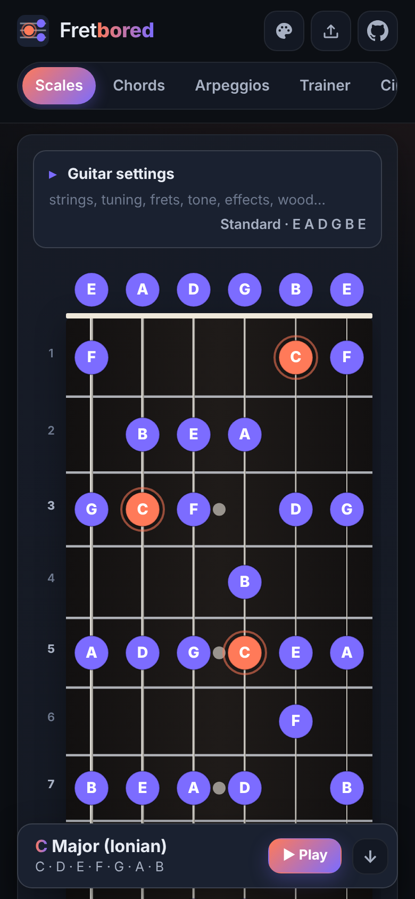
  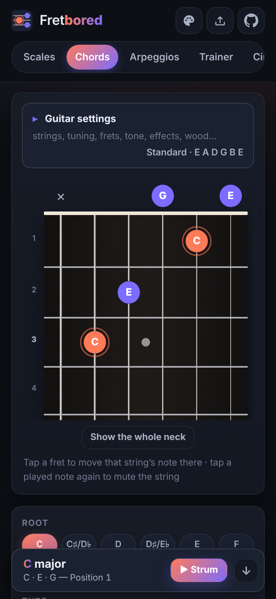
  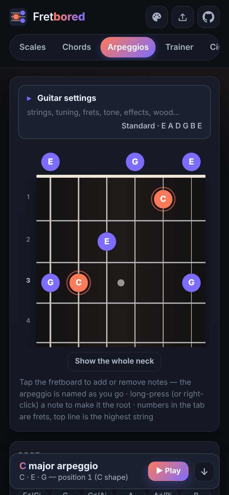
  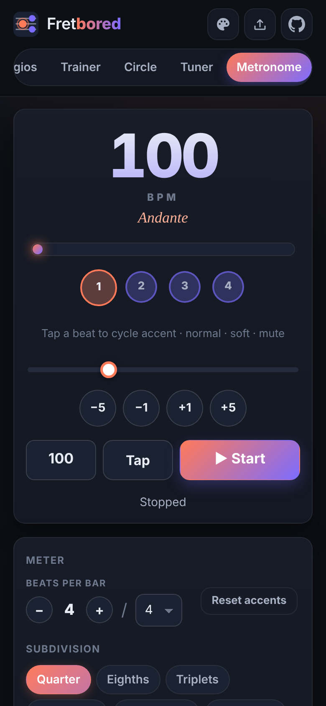

## Running it

Open `index.html` in a browser — that's it. It works offline from disk; everything (including the metronome sounds) is bundled.

To serve it locally instead: `npx http-server .` (or any static server).

## Install it as an app

On the hosted site Fretbored can be installed like an app — its own icon, full screen, works offline:

- **Android, Chrome/Brave/Edge:** tap **Install** in the top bar (or the browser menu → *Install app*).
- **Android, Firefox:** browser menu (⋮) → *Install* / *Add to Home screen*.
- **iPhone/iPad, Safari:** Share → *Add to Home Screen*.
- **Desktop Chrome/Edge:** the install icon in the address bar, or **Install** in the top bar.

Updates install themselves: each launch quietly downloads the latest version, which is used the next
time you open the app.

## Hosting on GitHub Pages

The site is static, so GitHub Pages can serve it straight from the repository:

1. Repository **Settings → Pages**.
2. Under **Build and deployment**, choose **Deploy from a branch**, pick the branch (e.g. `main`) and the `/ (root)` folder, then **Save**.
3. After a minute the site is live at `https://<user>.github.io/fretbored/`.

Live site: **https://singularity098.github.io/fretbored/**

(The `.nojekyll` file tells Pages to serve the files as-is.)

## Development

- No build step. Scripts are plain (non-module) JavaScript so the page works from `file://`.
- `node tests/theory.test.js` — tests for spelling, scale/chord matching and voicing generation.
- `node tests/pitch.test.js` — pitch detector accuracy tests.
- `node tests/smoke.browser.js` — headless-Chromium smoke test of every tab (desktop + phone); needs Playwright.
- `node tests/pwa.browser.js` — installable-app test (installability, offline, updates) over a local server.
- `node tools/screenshots.js [tab ...]` — re-captures the README screenshots in `docs/screenshots/` (default settings, desktop + phone).
- `node tools/make-icons.js` — re-renders the PNG app icons from `assets/icon.svg` / `assets/icon-maskable.svg`.
- `CLAUDE.md` — architecture, conventions and hard-won browser notes for AI-assisted development.
- `node tools/embed-sounds.js` — regenerates `js/sounds.js` after changing files in `assets/sounds/`.

| File | Purpose |
| --- | --- |
| `js/theory.js` | Note spelling, scale & chord library, matching, voicing generator |
| `js/tunings.js` | Preset tunings |
| `js/store.js` | Settings persistence, events, helpers |
| `js/audio.js` | Web Audio context, plucked-string synth, sample playback |
| `js/fretboard.js` | Shared SVG fretboard |
| `js/fbcontrols.js` | Guitar settings bar (tuning, frets, tone, wood…) and custom tuning editor |
| `js/pitch.js` | Pitch detection (McLeod pitch method) |
| `js/scales.js`, `js/chords.js`, `js/arpeggios.js`, `js/circle.js`, `js/trainer.js`, `js/metronome.js`, `js/tuner.js` | The tabs |
| `js/app.js` | Tabs, theme, startup |

See [Requirements.md](Requirements.md) for the full feature list.
